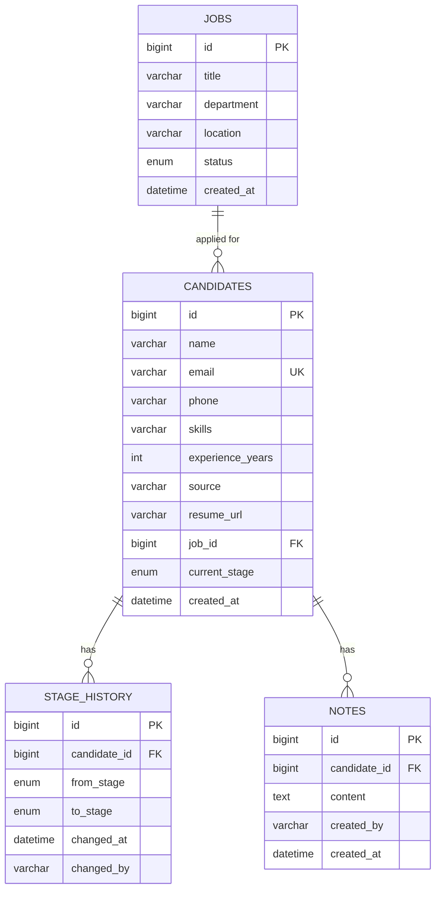

# Mini ATS

A lightweight applicant tracking system for recruiters. Post jobs, move candidates through a hiring pipeline, keep notes, and track hiring metrics on a dashboard.

**Live demo:** [mini-ats-cyan.vercel.app](https://mini-ats-cyan.vercel.app)


<!-- Add screenshots here, e.g.  -->

## Table of contents

- [Features](#features)
- [Tech stack](#tech-stack)
- [Architecture](#architecture)
- [Database schema](#database-schema)
- [API reference](#api-reference)
- [Getting started](#getting-started)
- [Environment variables](#environment-variables)
- [Deployment](#deployment)
- [Project structure](#project-structure)

## Features

- **Jobs:** create, list, edit and close postings. A job that has candidates cannot be deleted.
- **Candidates:** full CRUD with unique email, skills, experience, source, resume link and applied job.
- **Hiring pipeline:** `APPLIED → SCREENING → INTERVIEW → OFFER → HIRED`, plus `REJECTED`. Every move is recorded in a stage history table.
- **Kanban board:** drag and drop candidates between stages, with optimistic updates and automatic rollback if the API rejects a move.
- **Notes:** attach notes to any candidate.
- **Search and filters:** search by name, email or skill; filter by stage, job, source and experience. Pagination and sorting happen server-side.
- **Dashboard:** totals, count per stage, hires this month, funnel conversion, average time to hire, top sources, applications per job and per day (last 30 days).
- **Authentication:** JWT sign-in. All routes except login require a token, and admins can add teammates.

### Stage rules

| Rule | Behaviour |
| --- | --- |
| Active stages (`APPLIED` to `OFFER`) | Can move freely between each other, so recruiters can skip ahead or step back |
| `HIRED` | Reachable only from `OFFER` |
| `HIRED` and `REJECTED` | Final, no further moves |
| Invalid move | Returns `422` |

## Tech stack

| Layer | Tools |
| --- | --- |
| Backend | Java 17, Spring Boot 3.2, Spring Data JPA, Bean Validation, springdoc (Swagger) |
| Database | MySQL 8 (H2 for tests) |
| Frontend | React 19, Vite, React Router, Axios, Recharts, @hello-pangea/dnd, CSS |
| Scripts | Python 3 with `requests` |

## Architecture

```
React (Vite)  --HTTP/JSON-->  Spring Boot REST API (/api/v1)  --JPA-->  MySQL
                                controller -> service -> repository
```

- **controller:** maps HTTP to service calls and works only with DTOs.
- **service:** holds business rules such as stage transitions and dashboard calculations.
- **repository:** Spring Data, with JPA Specifications powering the dynamic candidate search.
- **exception:** a global `@RestControllerAdvice` returns one consistent error shape: `status`, `error`, `message`, `timestamp`, `fieldErrors`.
- Timestamps are stored and served in UTC.

## Database schema



The full DDL with indexes and foreign keys is in [`docs/schema.sql`](docs/schema.sql).

## API reference

Base path: `/api/v1`. Interactive docs are served at `/swagger-ui`.

| Method | Path | Purpose |
| --- | --- | --- |
| POST | `/auth/login` | Sign in and receive a JWT |
| POST | `/auth/register` | Admin only: add a user (`ADMIN` or `RECRUITER`) |
| GET | `/auth/me` | Current user |
| GET | `/jobs` | List jobs with candidate counts |
| POST | `/jobs` | Create a job |
| GET | `/jobs/{id}` | Get a job |
| PUT | `/jobs/{id}` | Update a job (set `status` to `CLOSED` to close) |
| DELETE | `/jobs/{id}` | Delete a job that has no candidates |
| GET | `/candidates` | Search: `keyword, stage, jobId, source, minExp, maxExp, page, size, sortBy, sortDir` |
| POST | `/candidates` | Create a candidate |
| GET | `/candidates/{id}` | Get a candidate |
| PUT | `/candidates/{id}` | Update a candidate |
| DELETE | `/candidates/{id}` | Delete a candidate |
| PATCH | `/candidates/{id}/stage` | Move stage: `{ "targetStage": "SCREENING" }` |
| GET | `/candidates/{id}/history` | Stage history, newest first |
| GET | `/candidates/{id}/notes` | List notes |
| POST | `/candidates/{id}/notes` | Add a note |
| GET | `/dashboard` | Dashboard metrics |

**Status codes:** `200`, `201`, `204`, `400` (validation), `404`, `409` (duplicate email, job in use), `422` (invalid stage move).

**Sorting:** `sortBy` accepts `id, name, email, experienceYears, source, currentStage, createdAt`. Any other value falls back to `createdAt`.

## Getting started

### Option 1: Docker

```bash
cp .env.example .env        # set DB_PASS
docker compose up --build
```

| Service | URL |
| --- | --- |
| App | http://localhost:5173 |
| API | http://localhost:8080/api/v1 |
| Swagger | http://localhost:8080/swagger-ui |

### Option 2: Run locally

**Requirements:** JDK 17, Maven 3.9, Node 20, MySQL 8.

```bash
# Backend
cd backend
export DB_USER=root DB_PASS=yourpassword
mvn spring-boot:run

# Frontend (in a new terminal)
cd frontend
npm install
npm run dev            # http://localhost:5173, /api is proxied to :8080
```

The backend creates the `mini_ats` database and tables on first start. To use the hand-written schema instead, run `docs/schema.sql` first.

### Signing in

On first start, an admin account is created from `ADMIN_EMAIL` and `ADMIN_PASSWORD` (default: `admin@miniats.com` / `Admin@123`).

> **Important:** change these defaults and set your own `JWT_SECRET` before deploying.

To add a teammate, sign in through Swagger (`POST /auth/login`), click **Authorize** with the returned token, then call `POST /auth/register`.

### Sample data and CSV export

```bash
cd scripts
pip install -r requirements.txt
python seed.py                      # ~60 candidates spread over the last 60 days
python export.py                    # writes candidates.csv
python export.py http://host/api/v1 out.csv
```

### Running tests

```bash
cd backend
mvn test
```

Tests cover the stage-transition rules and the candidate API (create, move, history, duplicate email, search).

## Environment variables

| Variable | Used by | Default | Notes |
| --- | --- | --- | --- |
| `DB_URL` | backend | local MySQL `mini_ats` | JDBC URL |
| `DB_USER` | backend | `root` | |
| `DB_PASS` | backend | `root` | |
| `CORS_ORIGIN` | backend | `http://localhost:5173` | Comma-separated list of allowed origins |
| `JWT_SECRET` | backend | dev value | Minimum 32 characters. Set your own in production |
| `JWT_EXPIRY_HOURS` | backend | `12` | Token lifetime |
| `ADMIN_EMAIL` | backend | `admin@miniats.com` | First admin, created only when no users exist |
| `ADMIN_PASSWORD` | backend | `Admin@123` | Change before going live |
| `ATS_EMAIL`, `ATS_PASSWORD` | scripts | the admin above | Used by `seed.py` and `export.py` |
| `PORT` | backend | `8080` | Set automatically by Render and Railway |
| `VITE_API_URL` | frontend | `/api/v1` (dev proxy) | Full API URL in production, set at build time |

## Deployment

### 1. Database (Railway or Aiven)

Create a MySQL 8 instance and build the JDBC URL from its host, port and database name:

```
jdbc:mysql://HOST:PORT/DBNAME?useSSL=true&serverTimezone=UTC
```

Aiven requires SSL. Tables are created on the first backend start.

### 2. Backend (Render or Railway, Docker)

1. Create a web service from this repo with root directory `backend`. The `Dockerfile` is detected automatically.
2. Set `DB_URL`, `DB_USER`, `DB_PASS` and `CORS_ORIGIN` (your Vercel URL, no trailing slash).
3. Deploy, then open `/swagger-ui` to confirm it is running.

### 3. Frontend (Vercel)

1. Import the repo with root directory `frontend`. Vite is detected and `vercel.json` handles routing.
2. Add `VITE_API_URL` = `https://your-backend-host/api/v1`.
3. Deploy, then add the final Vercel URL to the backend's `CORS_ORIGIN` and redeploy the backend.

## Project structure

```
mini-ats/
├── backend/    Spring Boot API + Dockerfile
├── frontend/   React app + Dockerfile (nginx) + vercel.json
├── scripts/    seed.py, export.py
├── docs/       schema.sql
├── docker-compose.yml
└── .env.example
```
