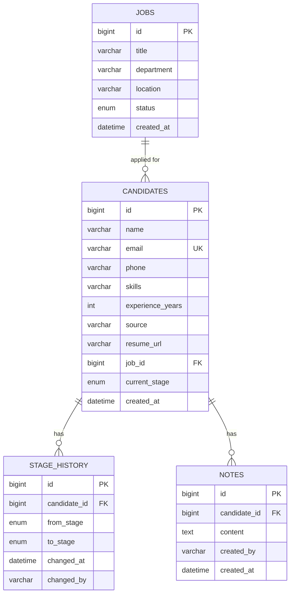

# Mini ATS

A small applicant tracking system for recruiters: post jobs, track candidates through a hiring pipeline, keep notes, and watch hiring metrics on a dashboard.

## Features

- Jobs: create, list, edit, close (a job with candidates cannot be deleted).
- Candidates: full CRUD with a unique email, skills, experience, source, resume link and applied job.
- Hiring stages: APPLIED, SCREENING, INTERVIEW, OFFER, HIRED, plus REJECTED. Every move is saved to a stage history table.
- Notes per candidate.
- Search by name, email or skill, with stage, job, source and experience filters. Pagination and sorting run on the server.
- Dashboard: totals, count per stage, hires this month, funnel conversion, average time to hire, top sources, applications per job and per day for the last 30 days.
- Sign-in with JWT. All API routes except login need a token; an admin can add teammates.
- Kanban pipeline with drag and drop, optimistic updates and rollback when the API rejects a move.

### Stage rules

Active stages (APPLIED to OFFER) can move to each other freely, so a recruiter can skip ahead or step back. HIRED is only reachable from OFFER. HIRED and REJECTED are final. Invalid moves return `422`.

## Tech stack

| Layer    | Tools                                                                  |
|----------|------------------------------------------------------------------------|
| Backend  | Java 17, Spring Boot 3.2, Spring Data JPA, Bean Validation, springdoc  |
| Database | MySQL 8 (H2 for tests)                                                 |
| Frontend | React 19, Vite, React Router, Axios, Recharts, @hello-pangea/dnd, CSS  |
| Scripts  | Python 3 with `requests`                                               |

## Architecture

```
React (Vite)  --HTTP/JSON-->  Spring Boot REST API (/api/v1)  --JPA-->  MySQL
                                controller -> service -> repository
```

- `controller` maps HTTP to service calls and only deals with DTOs.
- `service` holds the business rules (stage transitions, dashboard maths).
- `repository` uses Spring Data and JPA Specifications for the dynamic candidate search.
- `exception` has a global `@RestControllerAdvice` that returns one error shape: `status`, `error`, `message`, `timestamp`, `fieldErrors`.
- Timestamps are stored and served as UTC.

## ER diagram



The full DDL with indexes and foreign keys is in [`docs/schema.sql`](docs/schema.sql).

## API

Base path `/api/v1`. Interactive docs at `/swagger-ui`.

| Method | Path                           | Purpose                                        |
|--------|--------------------------------|------------------------------------------------|
| POST   | `/auth/login`                  | Sign in, returns a JWT                         |
| POST   | `/auth/register`               | Admin only: add a user (`ADMIN` or `RECRUITER`) |
| GET    | `/auth/me`                     | Current user                                   |
| GET    | `/jobs`                        | List jobs with candidate counts                |
| POST   | `/jobs`                        | Create a job                                   |
| GET    | `/jobs/{id}`                   | Get a job                                      |
| PUT    | `/jobs/{id}`                   | Update a job (set `status` to `CLOSED` to close) |
| DELETE | `/jobs/{id}`                   | Delete a job with no candidates                |
| GET    | `/candidates`                  | Search: `keyword, stage, jobId, source, minExp, maxExp, page, size, sortBy, sortDir` |
| POST   | `/candidates`                  | Create a candidate                             |
| GET    | `/candidates/{id}`             | Get a candidate                                |
| PUT    | `/candidates/{id}`             | Update a candidate                             |
| DELETE | `/candidates/{id}`             | Delete a candidate                             |
| PATCH  | `/candidates/{id}/stage`       | Move stage: `{ "targetStage": "SCREENING" }`   |
| GET    | `/candidates/{id}/history`     | Stage history, newest first                    |
| GET    | `/candidates/{id}/notes`       | List notes                                     |
| POST   | `/candidates/{id}/notes`       | Add a note                                     |
| GET    | `/dashboard`                   | Dashboard metrics                              |

Status codes: `200`, `201`, `204`, `400` (validation), `404`, `409` (duplicate email, job in use), `422` (invalid stage move).

`sortBy` accepts `id, name, email, experienceYears, source, currentStage, createdAt`. Anything else falls back to `createdAt`.

## Local setup

### With Docker

```bash
cp .env.example .env        # set DB_PASS
docker compose up --build
```

- App: http://localhost:5173
- API: http://localhost:8080/api/v1
- Swagger: http://localhost:8080/swagger-ui

### Without Docker

Requirements: JDK 17, Maven 3.9, Node 20, MySQL 8.

```bash
# backend
cd backend
export DB_USER=root DB_PASS=yourpassword
mvn spring-boot:run

# frontend (new terminal)
cd frontend
npm install
npm run dev            # http://localhost:5173, /api is proxied to :8080
```

The backend creates the `mini_ats` database and tables on first start. To use the hand-written schema instead, run `docs/schema.sql` first.

### Signing in

The first start creates an admin from `ADMIN_EMAIL` and `ADMIN_PASSWORD` (default `admin@miniats.com` / `Admin@123`). Change these and set `JWT_SECRET` before deploying. To add a teammate, sign in via Swagger (`/auth/login`, then Authorize with the token) and call `POST /auth/register`.

### Sample data and export

```bash
cd scripts
pip install -r requirements.txt
python seed.py                      # about 60 candidates over the last 60 days
python export.py                    # writes candidates.csv
python export.py http://host/api/v1 out.csv
```

### Tests

```bash
cd backend && mvn test
```

Covers the stage-transition rules and the candidate API (create, move, history, duplicate email, search).

## Environment variables

| Variable       | Where    | Default                       | Notes                                   |
|----------------|----------|-------------------------------|-----------------------------------------|
| `DB_URL`       | backend  | local MySQL `mini_ats`        | JDBC URL                                |
| `DB_USER`      | backend  | `root`                        |                                         |
| `DB_PASS`      | backend  | `root`                        |                                         |
| `CORS_ORIGIN`  | backend  | `http://localhost:5173`       | Comma-separated list of allowed origins |
| `JWT_SECRET`   | backend  | dev value                     | At least 32 characters. Set your own in production |
| `JWT_EXPIRY_HOURS` | backend | `12`                       | Token lifetime                          |
| `ADMIN_EMAIL`  | backend  | `admin@miniats.com`           | First admin, created only when no users exist |
| `ADMIN_PASSWORD` | backend | `Admin@123`                  | Change before going live                |
| `ATS_EMAIL`, `ATS_PASSWORD` | scripts | the admin above  | Used by `seed.py` and `export.py`       |
| `PORT`         | backend  | `8080`                        | Render and Railway set this for you     |
| `VITE_API_URL` | frontend | `/api/v1` (dev proxy)         | Full API URL in production, build time  |

## Deployment

### 1. Database (Railway or Aiven)

Create a MySQL 8 instance. Build the JDBC URL from its host, port and database name, for example
`jdbc:mysql://HOST:PORT/DBNAME?useSSL=true&serverTimezone=UTC`. Aiven requires SSL. Tables are created on the first backend start.

### 2. Backend (Render or Railway, Docker)

1. Create a new web service from this repo with root directory `backend`. The `Dockerfile` is picked up automatically.
2. Set `DB_URL`, `DB_USER`, `DB_PASS` and `CORS_ORIGIN` (your Vercel URL, no trailing slash).
3. Deploy and open `/swagger-ui` to check it is up.

### 3. Frontend (Vercel)

1. Import the repo with root directory `frontend`. Vite is detected and `vercel.json` handles routing.
2. Add `VITE_API_URL` = `https://your-backend-host/api/v1`.
3. Deploy, then put the final Vercel URL into the backend's `CORS_ORIGIN` and redeploy the backend.

## Project layout

```
backend/    Spring Boot API, Dockerfile
frontend/   React app, Dockerfile (nginx), vercel.json
scripts/    seed.py, export.py
docs/       schema.sql
```
